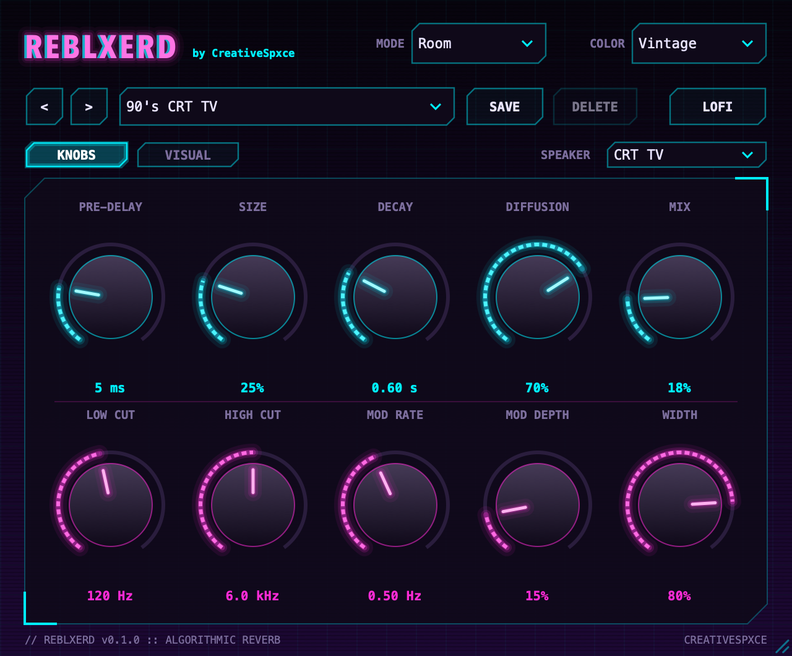
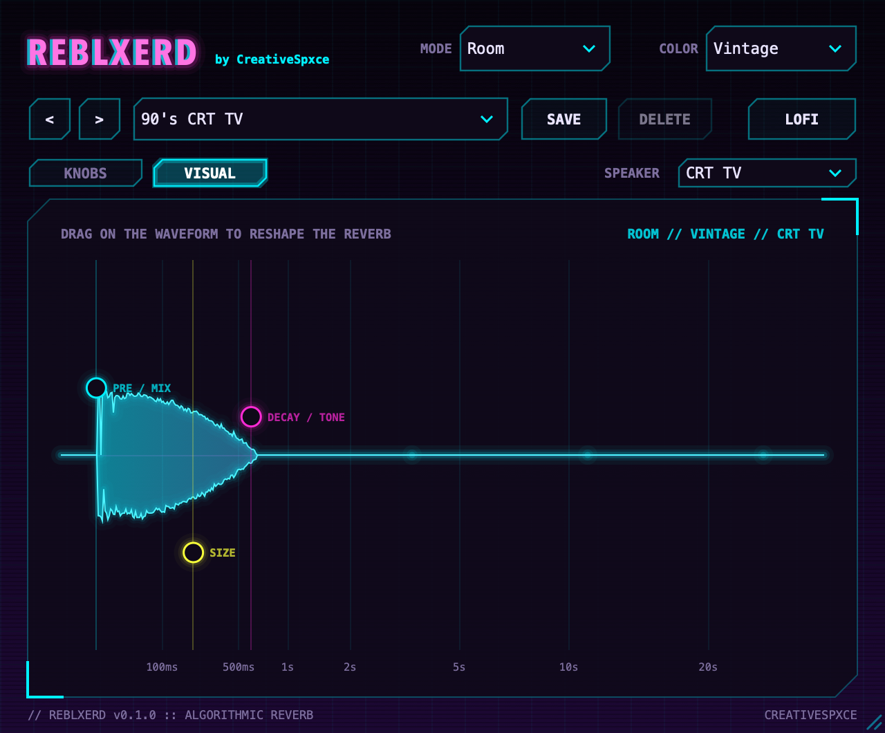

# Reblxerd



A multi-mode algorithmic reverb for macOS (VST3, AU and a standalone app), built with JUCE.
It's an original design in the spirit of classic "vintage" digital reverbs: several
modes with distinct character, plus a colour control that shapes bandwidth, motion and grit.

## Controls

| Control | What it does |
| --- | --- |
| **Mode** | Plate, Hall, Room, Chamber, Cathedral. Each mode has its own delay network, density and early reflections |
| **Color** | Modern (full bandwidth, clean), Vintage (band-limited, more wobble, slight saturation), Dark (soft, woolly) |
| Pre-Delay | Gap before the reverb starts, 0 to 500 ms |
| Size | How big the space is: from a tight, instant box to a huge room that swells in slowly. Stretches the reflections, diffusion and tank (0.3x to 2.5x); tail length stays set by Decay |
| Decay | RT60, 0.2 to 30 s |
| Diffusion | How quickly transients smear into a smooth wash |
| Mix | Dry/wet. Use 100% when the plugin sits on a send/return track |
| Low Cut / High Cut | Input high-pass, and damping inside the tank (darker tails at lower settings) |
| Mod Rate / Mod Depth | Delay-line modulation for chorus-like movement and to break up metallic ringing |
| Width | Stereo width of the wet signal |
| **Lofi** | Turns the wet signal into a filtered, fuzzy 8-bit version of the current reverb (band-pass, fuzz, ~11 kHz sample-and-hold, 8-bit quantise). Crossfades in, so it can be automated |

Drag the grip in the bottom-right corner to resize the window (640×530 up to 1920×1440). The knobs
and the waveform grow with it, and the size is saved with your session.

## Visual tab



The **VISUAL** tab swaps the knobs for the reverb's actual impulse response, rendered by the
engine in the background whenever a setting changes, so Mode, Color, Lofi and modulation all
show up in the shape. The time axis is stretched so the first few hundred milliseconds are readable.
Drag anywhere on the plot and the nearest handle follows:

| Handle | Left / right | Up / down |
| --- | --- | --- |
| **PRE / MIX** (cyan) | Pre-delay | Mix (height of the waveform) |
| **SIZE** (yellow) | | Size |
| **DECAY / TONE** (magenta) | Decay time | High Cut (higher = brighter tail) |

Drags are recorded as normal automation, and **SAVE** stores whatever you shaped as a user preset.

The playhead follows the audio going through the plugin: each new sound at the input (a hit, a
note, a phrase) starts it from zero, it moves through the tail in real time, and it dims as the
reverb dies away. A held note or steady pad starts it once rather than continuously.

## Presets

The preset bar holds 50 factory presets, ten per Mode, running from everyday settings
to experimental ones (lofi, extreme modulation, metallic resonators, frozen tails).
The arrows step through every preset; **Save** stores the current settings as a user preset and
**Delete** removes the selected user preset. User presets are XML files in
`~/Library/Audio/Presets/creativespxce/Reblxerd`, so they can be backed up or shared.

## How it works

`Source/dsp/ReverbEngine.*` is plain C++17 with no JUCE dependency:

1. Pre-delay, then a low-cut and colour-dependent band-limit filter
2. A tapped delay line for early reflections
3. Four series allpass diffusers
4. An 8-line feedback delay network with Hadamard mixing. Each line has a
   modulated, cubic-interpolated read, a damping lowpass and an in-loop allpass.
   The feedback gains are derived from the Decay setting so every line reaches
   −60 dB at the same time.
5. Orthogonal output taps for decorrelated left/right, an optional Lofi stage, then width and mix

Factory presets live in `Source/dsp/FactoryPresets.h`, also JUCE-free, so the tests render
every one. The JUCE layer (`PluginProcessor`, `PluginEditor`, `Parameters`, `PresetManager`)
maps parameters, handles preset files and draws the UI.

## Building

Requirements: Apple's command line tools (`xcode-select --install`), CMake 3.22+ and Ninja.

```bash
git submodule update --init --recursive
cmake --preset release
cmake --build --preset release
```

The build copies the plugin to `~/Library/Audio/Plug-Ins/VST3` and `~/Library/Audio/Plug-Ins/Components`.
Rescan plugins in your DAW to pick it up.

In VS Code, install the recommended extensions (CMake Tools, clangd, CodeLLDB), pick a preset
in the CMake panel and press Build.

## Tests

The engine tests build without JUCE. They check stability, measured RT60 against the
Decay setting, stereo decorrelation, Lofi behaviour, every factory preset and CPU use:

```bash
ctest --preset release
```

Pass a folder to `engine_tests` to also write impulse responses as WAV files.

## Licence notes

JUCE 8 is dual-licensed: AGPLv3, or a JUCE commercial licence (which includes a free
Starter tier below a revenue limit). Check which one applies before you sell or
distribute closed-source builds.

## Beta builds

Push a tag like `v0.1.0-beta1` and GitHub Actions (`.github/workflows/build.yml`) builds and tests
both platforms, then publishes a pre-release with:

- `Reblxerd-<version>-mac.dmg`: an installer for the VST3, AU and standalone app (Apple Silicon and Intel)
- `Reblxerd-<version>-win-setup.exe`: an installer for the VST3 and standalone app (64-bit Windows)

To build the Mac one locally: `packaging/mac/build-dmg.sh build/release <version> <output folder>`.
Builds are unsigned until signing credentials are added (see the script header), so testers will
see a one-time macOS "Open Anyway" / Windows "Run anyway" prompt, which each Read Me explains.
